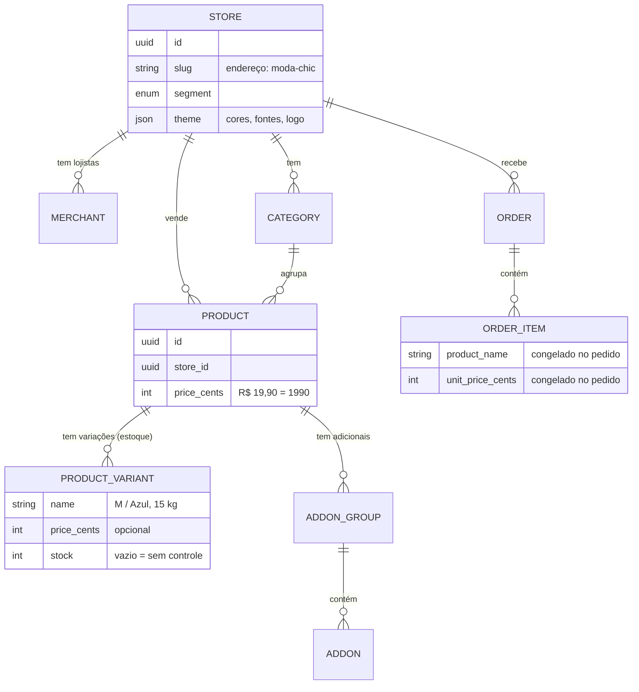

# Pertim Shop

**Tudo pertim d'ocê.**

Plataforma de pedidos para pequenos comércios. Várias lojas num sistema só, cada uma com o seu link e o seu visual, e o pedido saindo pronto para o WhatsApp.

> 🚧 **Em construção.** Etapa atual: **2 de 5, a API** (parte A pronta: banco de dados, catálogo e Swagger).

## Tecnologias

| Parte | Tecnologia |
|---|---|
| API | [Nest.js](https://nestjs.com) 12 com TypeScript, rodando em Node.js 24 |
| Banco de dados | PostgreSQL 17 com [Prisma](https://www.prisma.io) 7 (ORM e migrations) |
| Cache | Redis 7 |
| Documentação | Swagger (OpenAPI), em `/docs` |
| Infraestrutura | Docker e Docker Compose |
| Testes | Jest (testes de unidade e de ponta a ponta) |

Em breve: pedidos, login do lojista, testes no GitHub Actions e vitrine em Next.js.

## Como rodar

**Pré-requisito:** [Docker Desktop](https://www.docker.com/products/docker-desktop/) instalado e aberto.

Na pasta do projeto:

```bash
docker compose up --build
```

O comando sobe a **API**, o **PostgreSQL** e o **Redis**, cria as tabelas (migrations) e, se o banco estiver vazio, cria três lojas de demonstração. Depois abra no navegador:

- http://localhost:3333/docs: documentação interativa (Swagger)
- http://localhost:3333/stores: lojas da plataforma
- http://localhost:3333/health: saúde da API

Para desligar, use `Ctrl + C` ou rode `docker compose down`.

### Lojas de demonstração

| Loja | Segmento | Endereço |
|---|---|---|
| Moda Chic | Roupas e acessórios | `/stores/moda-chic` |
| Fome-Sô | Lanchonete | `/stores/fome-so` |
| Bicho Bão Pet Shop | Pet shop | `/stores/bicho-bao` |

Todas usam a mesma API. O que muda é o tema (cores, fontes, logo), que fica salvo no banco.

### Testes

```bash
cd api
npm install
npm test           # testes de unidade
npm run test:e2e   # testes de ponta a ponta
```

> Os testes precisam do Node.js 24.9 ou mais novo.

## Endereços da API

| Método | Endereço | O que faz |
|---|---|---|
| GET | `/stores` | Lista as lojas ativas |
| GET | `/stores/:slug` | Dados da loja e tema (visual) |
| GET | `/stores/:slug/categories` | Categorias, com a quantidade de produtos |
| GET | `/stores/:slug/products` | Produtos, com filtro `?category=` e busca `?search=` |
| GET | `/stores/:slug/products/:id` | Produto completo: variações e adicionais |
| GET | `/health` | Confere a API, o banco e o Redis |

## Banco de dados



O desenho completo fica em [`api/prisma/schema.prisma`](api/prisma/schema.prisma).

## Estrutura

```
pertim-shop/
├── api/                    API em Nest.js
│   ├── prisma/             desenho do banco (schema) e migrations
│   ├── src/
│   │   ├── stores/         lojas e temas
│   │   ├── catalog/        categorias e produtos
│   │   ├── demo/           dados das lojas de demonstração
│   │   ├── prisma/         conexão com o banco
│   │   ├── redis/          conexão com o Redis
│   │   ├── health/         endpoint /health
│   │   └── config/         validação das variáveis de ambiente
│   ├── test/               testes de ponta a ponta
│   └── Dockerfile          receita da imagem da API
├── docker-compose.yml      sobe API, PostgreSQL e Redis juntos
└── .env.example            modelo das configurações
```

## Decisões técnicas

- **Uma plataforma para várias lojas.** Um sistema só atende todos os comércios. Cliente novo vira um cadastro, não um projeto novo. *Para um único cliente, um site em Next.js com Supabase bastaria.*
- **Isolamento entre lojas.** Toda consulta começa pela loja e filtra pelo id dela. Um produto de outra loja responde "não encontrado", mesmo com o id certo. Há testes para isso.
- **O visual é um dado, não código.** O tema de cada loja (cores, fontes, logo) fica no banco. Criar uma loja nova ou mudar o visual não exige programar.
- **Um formato de produto para todos os segmentos.** As *variações* (tamanho, cor, peso, voltagem) guardam preço e estoque; os *adicionais* (bacon, ponto da carne) têm mínimo e máximo de escolhas. Serve para loja de roupas, lanchonete e pet shop.
- **Preços em centavos.** R$ 19,90 é guardado como 1990, o que evita erros de arredondamento.
- **O estoque exato não é público.** A vitrine recebe só "disponível" e "últimas unidades".
- **As fotos ficam fora da API.** Elas são servidas pela vitrine, e a API só guarda o caminho. Isso economiza o tráfego do servidor.
- **Migrations versionadas.** Cada mudança no banco vira um arquivo SQL no repositório, e qualquer máquina recria o banco igual.
- **Dados de demonstração num lugar só.** A mesma função cria as lojas no primeiro start e vai servir para o botão "restaurar dados".
- **Docker.** Qualquer pessoa clona o repositório e roda tudo com um comando. A imagem tem 3 etapas, leva só o necessário e roda sem permissão de administrador. *Seria exagero num site estático, sem banco.*
- **`/health` responde 503 quando algo cai.** A hospedagem usa esse código para saber que a API não está saudável.
- **Nenhum arquivo passa de 300 linhas.** Uma regra automática do linter (oxlint) impede arquivos gigantes.
- **Configuração por variáveis de ambiente.** Senhas e endereços não ficam no código. Se faltar alguma variável, a API avisa qual é e não liga.

## Roteiro

- [x] **Etapa 1:** ambiente com Docker (API, PostgreSQL e Redis)
- [ ] **Etapa 2:** API
  - [x] banco de dados, lojas de demonstração, catálogo e Swagger
  - [ ] pedidos, login do lojista (JWT) e painel
- [ ] **Etapa 3:** cache com Redis, limite de pedidos, testes no GitHub Actions e teste de carga
- [ ] **Etapa 4:** vitrine em Next.js e painel do lojista
- [ ] **Etapa 5:** publicação (Render, Neon e Vercel)

## Autor

**Fernando Pablo**, da [Lychnos Tech](https://lychnos-portfolio.vercel.app)
[LinkedIn](https://www.linkedin.com/in/fernandopablogomes) · [GitHub](https://github.com/fernando-pablo)
